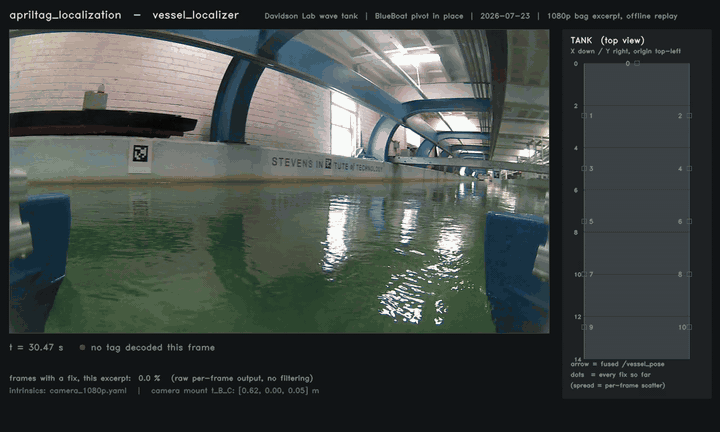

# apriltag_localization

Full 6-DoF pose estimation of a surface vessel (ASV) inside a tank, from AprilTags mounted on
the tank walls. A ROS 2 (Jazzy, `ament_python`) package providing the **`vessel_localizer`**
node: it consumes AprilTag detections, solves each tag's pose with OpenCV `solvePnP`, chains
the transforms through a known tag map, fuses every visible tag into a single estimate, and
publishes the vessel's pose as a stamped `geometry_msgs/PoseStamped`.

[](docs/media/demo.mp4)

<sub>**BlueBoat pivoting in place, Davidson Laboratory wave tank, 2026-07-23.** Left: the
camera stream with every decoded tag outlined and magnified, labelled with the range
`solvePnP` returned. Right: the tank from above — mapped tags light up as they are decoded,
the arrow is the published `/vessel_pose`, and the grey scatter is every fix so far. A single
tag carries the fix until tag 5 enters view and fusion takes over. Rendering notes, the
numbers for the whole run, and the reason this is an excerpt are in [Demo](#demo).</sub>

## Why this exists

The vessel's **primary** navigation is an inertial-lidar system (lidar + IMU). It works well
in open water but dead-reckons: it integrates relative motion with no absolute reference, so
its estimate drifts. The Davidson Lab wave tank is a worst case for it — a geometrically
simple, feature-poor box where the lidar has little to lock onto. This package is the
**secondary, absolute** layer: tags at surveyed wall positions plus a forward-facing camera
give a drift-free position fix to correct the primary system.

This package does **pose estimation**, not detection. It expects tag detections on `/tags`
(e.g. from [`apriltag_detector`](https://github.com/aaronreycast/apriltag_detector)) plus the
camera intrinsics on `/camera/camera_info`.

## How it works

For every detected tag that exists in the map, the node builds the chain
(world ← tag ← camera ← boat):

```
T_W_B = T_W_T · inv(T_C_T) · inv(T_B_C)
```

| Transform | Meaning | Source |
|-----------|---------|--------|
| `T_C_T` | tag pose in the camera frame | `solvePnP` (corners + tag size + intrinsics) |
| `T_W_T` | tag pose in the world | `tag_map.yaml` |
| `T_B_C` | camera pose on the boat (mount) | measured, `make_camera_mount()` |

The full SE(3) matrix is carried through to the output: translation is read off
`T_W_B[:3,3]`, and the rotation block is converted to a quaternion with **Shepperd's
four-branch method**, implemented locally rather than pulling scipy onto the Jetson. The
branch selection is load-bearing — a single-branch formula divides by `w = cos(θ/2)` and
blows up at θ = 180°, which is a perfectly reachable vessel heading (and the one the boat
sits at whenever it faces a far-wall tag).

**Multi-tag fusion is two-pass, and the order is load-bearing.**

*Pass 1 — rotation.* The per-tag rotations are combined by **Markley quaternion averaging**
(`M = Σ wᵢ qᵢqᵢᵀ`, top eigenvector via `np.linalg.eigh`), weighted by `decision_margin`.
Component-wise averaging of rotations is invalid — the result leaves SO(3) — and the 2D
cos/sin yaw trick this node used before 6-DoF does not generalise to three axes. Because `M`
is built from `qqᵀ`, the double cover is handled for free: `q` and `−q` give a bit-for-bit
identical result.

*Pass 2 — position, re-derived against that single fused rotation:*

```
p_W_C = p_W_T − R_W_C · t_C_T          R_W_C = R_W_B · R_B_C
p_W_B = Σᵢ wᵢ p_W_Cᵢ − R_W_B · t_B_C
```

**Why not simply average the per-tag `T_W_B` translations?** Because each of those was built
with *that tag's own* rotation, and orientation from a single 0.135 m tag is badly
conditioned — **20–41°/px at 2.0–2.85 m**, while position from the same corners is ~40×
better determined. A per-tag yaw error `δθ` on a tag at camera-frame lateral offset `X`
displaces that tag's position by roughly `X·δθ`. Two tags straddling the boresight have
opposite `X` **and** opposite `δθ`, so the two products **share a sign**: the errors cancel in
`x` and **rectify** in `y`. Averaging cannot repair that — the damage is done per-tag,
upstream of the average.

Measured on hardware (2026-08-11, tags 1+3, tripod, station known to ±5 mm): per-tag yaw
`−95.45°` and `−84.82°` — 10.6° apart, yet their *mean* correct to 0.2° — produced **11 mm of
`x` error and 147 mm of `y` error**. Re-deriving the positions from the fused rotation took
the radial error from **157 mm to 26 mm**, and improved `y` precision 3× as a side effect
(IQR 2.0 mm → 0.7 mm), since the fused `y` no longer inherits the differential jitter between
two independent rotation estimates.

Note pass 2 evaluates the *same identity* the per-tag chain already contained — expand
`T_W_T · inv(T_C_T)` and it falls out. Only the rotation input changes.

**With a single visible tag this reduces exactly to the old behaviour**, since the fused
rotation is then that tag's own. A lone tag is still worth ~0.3 m of position error — see
[Open work](#open-work).

Weak detections (`decision_margin < 30`) and unmapped tag IDs are rejected before fusion.

### World frame

Tank top-view: origin at the top-left corner, **X points down, Y points right, Z up**
(water surface = `z = 0`). Tags are mounted upright on the walls; each map entry's
`theta_deg` is the wall-normal heading (top wall `0°`, left wall `90°`, right wall `-90°`).

## Demo

The clip above was **rendered offline from a recorded bag**, not screen-captured:
[`tools/render_bag_demo.py`](tools/render_bag_demo.py) reads
`pivot_in_place_trial_02_1080p` (36 s, 1069 frames, Davidson Lab, 2026-07-23), imports this
node's own PnP / transform-chain / fusion functions, and composites the result — so the pose
on screen is produced by the shipped code, and the mount printed in the HUD is read back out
of `make_camera_mount()` rather than typed in. Reproduce it with:

```bash
python3 tools/render_bag_demo.py <bag> \
    --calib ../apriltag_detector/apriltag_detector/config/camera_1080p.yaml \
    --out demo.mp4 --start 30.4 --end 36.1
```

What is worth reading in it:

- **Fusion handing over between tags — and this is the clearest thing in the clip.** The fix
  rests on **tag 3 alone** until tag 5 enters view at t ≈ 32 s, after which both are fused.
  The map panel shows which tags are live. The arrow steps **0.42 m** at the handover and
  then settles into a visibly tighter knot. That step is not noise: single-tag position is
  dominated by that one tag's ill-conditioned orientation and is worth ~0.3 m at bench range
  (see [Open work](#open-work)), and the settling is two-pass fusion taking over.
- **The scatter is real and unfiltered.** Every published fix is drawn, and none are smoothed
  or rejected after the fact. It is deliberately *not* joined into a track line, which would
  imply a continuity the raw output does not have. Over the excerpt the fixes span **1.04 m in
  x and 0.24 m in y**; restricted to the two-tag stretch after the handover, **0.80 m and
  0.16 m**. The y figure is the one to watch — before the two-pass fusion change it was
  **0.73 m** over that same stretch, a 4.6× difference on identical input.
- **`frames with a fix: 48 %`** in the excerpt. Across the whole bag it is **32.4%**: of 1069
  camera frames the detector emitted `/tags` for 592 (55%) — this is the 1080p throughput
  collapse that later drove the switch to 720p — and of the detections in those frames, **205
  were rejected by the ambiguity gate**, leaving 346 published poses. Without the gate it is
  46.2% / 494 poses. So roughly **a third of the drop-outs you see are now deliberate**: frames
  where the overlay shows a tag but no fix appear as `N detection(s) rejected - ambiguous pose`
  rather than as detector misses, and the two are labelled separately on purpose.

**This is a 5.6 s excerpt (t = 30.4–36.1).** It was originally chosen as the longest continuous
stretch free of **pose-ambiguity flips**, which at the time was a real open defect: over the
full 36 s, **20.3%** of published fixes landed more than 0.5 m from their own local median, in
bursts lasting a few tenths of a second. **That defect was fixed on 2026-08-12** by a rejection
gate on the IPPE solution ratio (see [Open work](#open-work)), which cut the full-run outlier
rate to **6.6%** and took the number of flip-free stretches ≥2 s from 5 to 8, the longest from
3.6 s to 7.3 s. The excerpt is **kept at the same window** so it reads as a direct before/after
against the previously published clip, and it is no longer the only clean part of the run.

**The uncut 36 s render is kept alongside it** at
[`docs/media/demo_full_uncut.mp4`](docs/media/demo_full_uncut.mp4). The accumulating scatter in
its map panel is the clearest single piece of evidence for the gate: rendered with
`--min-pose-ratio 0.0` the cloud sprays a smeared tail across ~4 m of tank; at the 1.5 default
it is a compact blob on the vessel. Both renders come from the same command with one flag
changed, so the comparison can be reproduced rather than taken on trust.

Two caveats stated on the frame itself: the bag is **1080p** (recorded before 720p became the
operating resolution), and the intrinsics are the **corrected** `camera_1080p.yaml`. The
second is a deliberate substitution — the bag's own `/camera/camera_info` predates the
2026-07-28 metric rescale and carries `fx = 1022.34` against the verified 948.36, so replaying
it naively reproduces a ~8% range error. The HUD also prints the camera mount in force, which
is the **measured** `[0.62, 0.00, 0.05]` since 2026-08-11; only `x`, `y` and `yaw` are drawn
because the map panel is two-dimensional, not because `z` is untrustworthy.

**What is inferred rather than measured here, stated plainly.** This bag has **no ground
truth** — the boat's true position was never surveyed during the run. The two-pass fusion and
the measured mount are validated on a *bench* station known to ±5 mm (26 mm radial, see
[Status](#status)); nothing in this clip re-measures that. Applying the 2026-08-07 mount to a
2026-07-23 bag is legitimate because the camera was not remounted in between, but that is
operator knowledge, not a measurement. And one honest wrinkle: over the two-tag stretch the
two-pass change tightened `y` 4.6× but **widened `x` from 0.66 m to 0.80 m**, which the bench
result does not predict and which no ground truth here can adjudicate.

## Node: `vessel_localizer`

| | Topic | Type |
|---|-------|------|
| **Subscribes** | `/tags` | `apriltag_msgs/AprilTagDetectionArray` |
| **Subscribes** | `/camera/camera_info` | `sensor_msgs/CameraInfo` |
| **Publishes** | `/vessel_pose` | `geometry_msgs/PoseStamped` — full 6-DoF: `pose.position` (x, y, z in metres) + `pose.orientation` (unit quaternion). `header.stamp` is the **image-acquisition time** (copied from `/tags`, not publish time); `header.frame_id` is the `frame_id` parameter. |

**Parameters**

| Name | Default | Description |
|------|---------|-------------|
| `tag_map_path` | `config/tag_map.yaml` (via launch) | Absolute path to the tag-map YAML |
| `frame_id` | `map` | World frame stamped into `header.frame_id` of the published pose. **Must match what the downstream EKF expects** — a mismatch corrupts fusion silently. Not exposed as a launch argument; override with `--ros-args -p frame_id:=...`. |
| `min_pose_ratio` | `1.5` | Planar-ambiguity rejection gate: minimum `err[1]/err[0]` from `solvePnPGeneric` for a detection to be used. See [Open work](#open-work) for how 1.5 was chosen and what it costs. **`0.0` disables it.** Unlike the two above, this one is **settable at runtime** — `ros2 param set /vessel_localizer min_pose_ratio 1.2` — because it is the one value that can only honestly be tuned against real geometry, and on the water a relaunch costs a station. Changing it resets the gate tally. A negative value is rejected rather than clamped. |

> **`/tags` rate is not the pose rate.** The detector publishes an `AprilTagDetectionArray`
> on *every* frame, empty or not, so `pose rate = detector throughput × detection fraction`.
> Measure `/vessel_pose` when the number being quoted is a pose rate — one run read `/tags`
> at 31.2 Hz while `/vessel_pose` managed 1.3 Hz.

## Tag map format

`config/tag_map.yaml` — positions in metres, angles in degrees:

```yaml
default_tag_size: 0.135      # black-square edge length (m)
tags:
  0:
    x: 0.0
    y: 2.5
    z: 0.2415                # tag-centre height above the still-water surface
    theta_deg: 0.0           # wall-normal heading
    # size: 0.135            # optional, overrides default_tag_size
  1:
    x: 2.5
    y: 0.0
    z: 0.2415
    theta_deg: 90.0
```

The file is the single source of truth for tank geometry — no dimension is hardcoded in the
node. Two entries are worth knowing about:

- **`z = 0.2415` is derived, not guessed:** the laminated sheet's top edge is aligned with
  the wall top at 0.36 m above still water, and the black-square centre sits 0.1185 m below
  that edge.
- **Tag 0's `y` is `tank_width / 2`**, because tag 0 is physically centred between the side
  walls. It is the one map entry that tracks another measurement rather than standing alone:
  when the tank width was tape-measured at 5.0 m (previously assumed 4.9 m), tag 0 moved with
  it and the far-wall tags all shifted +0.10 m.

## Build

```bash
cd ~/Workspaces/apriltag_ws
colcon build --packages-select apriltag_localization --symlink-install
source install/setup.bash
```

Requires `apriltag_msgs` (from the detector stack), `rclpy`, `sensor_msgs`, `geometry_msgs`,
and OpenCV (`cv2`) + `numpy` + `pyyaml` in the Python environment.

## Run

Start a detector publishing `/tags` and `/camera/camera_info` (see `apriltag_detector`), then:

```bash
ros2 launch apriltag_localization localize.launch.py
# custom map:
ros2 launch apriltag_localization localize.launch.py tag_map_path:=/abs/path/to/tag_map.yaml
```

Inspect the output:

```bash
ros2 topic echo /vessel_pose
ros2 topic hz  /vessel_pose     # the pose rate; /tags is NOT it
```

When two or more mapped tags are visible, the node also logs each tag's independent estimate
and the fused result (throttled to 1 Hz) for validation.

## Status

The node is validated end-to-end on hardware — single tag and multi-tag fusion — at the
current operating resolution of **720p**. Full log:
[`docs/PHASE3_LOCALIZATION_RESULTS.md`](docs/PHASE3_LOCALIZATION_RESULTS.md).

| Check | Result | Date |
|---|---|---|
| Multi-tag fusion, tags 1+3 vs tape truth | **~4 cm radial, 0.6° yaw** (fused `3.905, 2.673, −90.63°` vs expected `3.87, 2.70, −90°`) | 2026-07-09 *(480p)* |
| Pose stamp carries image-acquisition time | **PASS, 7/7 exact** to the nanosecond, concurrent capture | 2026-08-05 |
| Transform chain re-derived independently from raw corners | agrees to **3 / 10 / 6 mm** and 0.1–0.2°, across frames 2.6 s apart | 2026-08-05 |
| Frame-to-frame jitter, single tag, static, 2.6 m | **~12 mm radial** | 2026-08-05 |
| Edge-of-frame *detection* at 720p | **~100% out to 80% of the half-field** (46.6° bearing, obliquity to 42°, 3.0 px/cell) | 2026-08-05 |
| Off-axis *metric accuracy* at 720p | **flat −0.7% out to ~70% of half-width** (\|u_off\| ≲ 450 px, ±26°); **−3.06% at 85%** | 2026-08-10 |
| Level-bench roll / pitch | roll **+0.003°**, pitch +1.50° (the tripod head, not the mount) | 2026-08-10 |
| Camera mount `t_B_C` applied and validated | differential Δy **+417.1 mm** vs +421.4 predicted, Δz **+448.9** vs +447.2, Δyaw +0.026° | 2026-08-11 |
| **Multi-tag fusion, tags 1+3, after the two-pass fix** | **26 mm radial, 0.11° yaw** (fused `3.8767, 3.0948, −90.109°` vs truth `3.888, 3.118, −90.0°`), station known to ±5 mm | 2026-08-11 *(720p)* |
| Static precision, 2 tags, 940 samples | x IQR 3.3 mm, **y IQR 0.7 mm**, z 4.1 mm, yaw 0.064°, **0 flips** | 2026-08-11 |
| **Single** visible tag, same station | **~0.3 m radial** (308 mm tag 1, 331 mm tag 3) — see [Open work](#open-work) | 2026-08-11 |
| **Ambiguity gate, on-water bag** (`min_pose_ratio` 1.5) | >0.5 m outliers **20.3% → 6.6%** for 30% of fixes; pose rate 13.8 → 10.1 Hz | 2026-08-12 |
| Ambiguity gate on clean data | **inert — 0 of 3752** static-fixture detections gated at any threshold up to 2.0 | 2026-08-12 |

**Ranges are metric at all three resolutions.** The original ~+7.2% range-scale error was a
calibration fault, not a localization one: the checkerboard calibrator is unstable on this
wide, distorted lens (the focal↔distortion ambiguity — two fits disagreed by 17%), so a
**physical range test is the source of truth**. Each resolution was rescaled and then
re-verified over a fresh set of stations:

| res | fx / fy after rescale | verified slope | note |
|---|---|---|---|
| 480p | 424.29 / 424.67 | 1.001 | was +7.2% long |
| **720p** | **632.88 / 631.77** | **1.0002** | was −2.5% **short** — the opposite direction |
| 1080p | 948.36 / 946.28 | 1.005 | was +7.9% long |

As an independent cross-check the two 16:9 modes agree without ever having been compared
during calibration: 720p's `fx × 1.5 = 949.32` against 1080p's measured `948.36`, 0.10%
apart. Procedure: `apriltag_detector/docs/CAMERA_CALIBRATION.md` §5c.

## Open work

- **Planar pose ambiguity — GATED as of 2026-08-12, with a residual that a gate cannot reach.**
  A square tag viewed by a single camera admits **two** poses that both reproject nearly
  onto the observed corners, mirrored about the tag plane. `cv2.solvePnP` returns only one
  and gives no indication that the other was close. Re-solving this bag with
  `cv2.solvePnPGeneric` shows how marginal the choice usually is: across 619 detections the
  ratio of the two solutions' reprojection errors has a **median of 2.01**, with **33% below
  1.5**. When the solver takes the wrong branch the vessel pose jumps metres — at t = 28.90 s
  the two solutions sat at 0.394 px and 0.627 px error and the one returned put the boat at
  (2.40, 0.96) instead of ≈ (5.9, 2.3). **20.3% of the published fixes in this run landed more
  than 0.5 m from their own local median** (18.5% before the 2026-08-11 fusion change — the
  two-pass fix targets a different failure mode and does not help here; measured, not assumed:
  the correlation between a frame's IPPE error ratio and how much the fusion change moved it
  is **−0.065**, i.e. none).

  **The fix, and why it is rejection rather than disambiguation.** `tag_pose_in_camera` calls
  `solvePnPGeneric` and reports `ratio = err[1]/err[0]`; `on_tags` drops any detection with
  `ratio < min_pose_ratio` (default **1.5**, runtime-settable, `0.0` disables). Disambiguating
  against the other visible tags was implemented and measured **first** — it only moved the
  outlier rate 20.3% → 16.7%, because **75% of this bag is single-tag** and a lone tag has no
  second opinion to check against. Rejection reached **6.6%** on the same data. The threshold
  came from a sweep over two tank bags whose knee sits in the same place despite very different
  motion; past 1.5 you pay ~10% of your fixes per point of outlier. 1.5 rather than 1.2 because
  this is a *secondary absolute* layer correcting a drifting INS, so a trustworthy fix is worth
  more than a frequent one.

  | | fixes | >0.5 m outliers | pose rate |
  |---|---|---|---|
  | gate off | 497 | 101 (**20.3%**) | 13.8 Hz |
  | **gate 1.5** | 347 (−30%) | 23 (**6.6%**) | 10.1 Hz |

  **Cost is 27–30% of fixes and ~4 Hz**, acceptable only because the consumer is an EKF that
  already dead-reckons between fixes. The gate is **provably inert on clean data**: on a static
  two-tag bench fixture the median ratio is 4.36 and **0 of 3752** detections fall below any
  gate up to 2.0.

  **What remains, and why no gate can fix it: ~6.6% of fixes are still outliers.** A
  *confidently wrong* solution — high ratio, wrong branch — is indistinguishable from a
  confidently right one at the single-detection level, which is all this node sees. Removing
  those needs temporal consistency against a motion model, which belongs in the EKF consuming
  `/vessel_pose`, not here. Note also that **multi-tag fusion does not rescue this on its own**
  — a flipped estimate enters the weighted average with a full `decision_margin` weight,
  because the decode was clean; the ambiguity is in the geometry, not the decode.

- **A single visible tag is worth ~0.3 m, and the two-pass fusion cannot help it.** With one
  tag there is no second rotation to average against, so fusion reduces to the old behaviour
  and the tag's own ill-conditioned orientation goes straight into its position — measured at
  **308 mm and 331 mm** for tags 1 and 3 at the same station where two-tag fusion scored
  26 mm. This is the *common* tank case, not an edge case, and it is currently published with
  no indication that it is 12× worse than a two-tag fix. Note the error is a **stable
  systematic, not noise** — single-tag yaw is repeatable to an IQR of 0.060° while being wrong
  by 5.58°, so no amount of temporal averaging removes it.

  **This is a missing input, not a policy choice.** Measured on the 07-23 bag: giving every tag
  one good rotation instead of its own takes inter-tag position disagreement from **0.341 m to
  0.150 m**, and the per-tag disagreement is what produces the **0.148 m median step at every
  tag handover** — the streaks visible in the uncut demo. The obvious workaround, *carry the
  last multi-tag fused rotation forward*, was implemented and **refuted**: it makes single-tag
  frames worse (median spread 0.047 m → 0.171 m), because the boat turns at a median 4.7°/s so
  a one-second-old rotation is already staler than the error it replaces.

  The fix is to take yaw from the **IMU/INS**. The two sensors are exactly complementary — tag
  orientation is ill-conditioned (20–41°/px) while tag position from the same corners is ~40×
  better determined, and the INS is the mirror image: good short-term yaw, drifting position.
  `fuse()` is already two-pass and its second pass consumes exactly one rotation, so this is a
  substitution rather than a redesign. It inverts a dependency, though — this node currently
  only *produces* orientation — so it needs agreement from whoever owns the EKF.

- **Tag-to-tag disagreement of ~0.15 m that rotation does not explain.** After the above, tags
  still disagree by 0.150 m median. The remaining candidates are the unmeasured mount rotation
  (below) and **error in the tag survey itself**: `tag_map.yaml`'s tank positions have never
  been validated against the physical tank — every result here is from a lab-wall replica,
  which tests the code, not the survey. A map error produces exactly this signature. Inter-tag
  *distance* is the mount-independent way to check it.
- **Mount rotation is still assumed, not measured.** `make_camera_mount()` takes the camera
  to be perfectly forward and level. Measure it through the camera's own optics rather than
  with a protractor: a tag at known height dead ahead projects to `(cx, cy)` only if the mount
  is perfect, so `pitch ≈ atan((v−cy)/fy)` and `yaw ≈ atan((u−cx)/fx)`. At 720p one pixel is
  0.091°. **It cannot be done on a bench** — the same camera read pitch +1.50° on 2026-08-10
  and +0.06° on 2026-08-11, so a bench reading measures the tripod head. It has to happen on
  the boat, floating in normal loaded trim, validated with a 180° spin test.
- **The physical tank tag positions have never been validated end-to-end.** Everything in the
  table above was measured on a lab-wall replica of the tank geometry, which certifies the
  *code* against `tag_map.yaml` but says nothing about whether the tags on the real tank walls
  are where the map claims.

## Gotchas worth knowing

- **`cv2.SOLVEPNP_IPPE_SQUARE` corner order.** It requires object/image points in
  `TL, TR, BR, BL`, whereas the `/tags` message delivers corners as `BL, BR, TR, TL` — the
  node reverses them. Feeding the message order directly yields a *degenerate* pose
  (tvec `Z ≈ 0`, huge reprojection error) while Y and yaw still look plausible. Silent trap.
- **`decision_margin` is not a detection-health metric.** It reports how cleanly a tag
  decoded *given that it decoded*. Margins held at 165–215 through a station that was
  detecting only 3.6% of frames — a badly mounted tag. The `decision_margin < 30` filter
  here rejects weak decodes, not missing ones; do not read it as a health signal.
- **Replaying an old bag replays its old intrinsics.** `/camera/camera_info` from the bag
  overwrites the node's cached `K` at camera rate, so bags recorded before 2026-07-28 drive
  the localizer with pre-rescale intrinsics and produce poses that read long.
- **Tag size is coupled to `fx`.** The tag is caliper-measured at 135.3 mm but `tag_size` is
  0.135 everywhere (−0.22%). That bias is absorbed into the range-test `fx` *and* into this
  node's `default_tag_size`, so it cancels. Changing one without rescaling the other silently
  reintroduces a 0.22% range error.

## License

This software is issued under the Apache License, Version 2.0.
